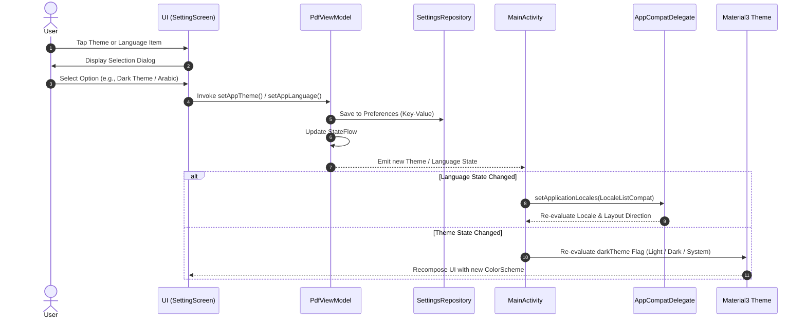

# Architecture Specification: App Theme & Per-App Locale Management

This document details the complete architectural design and implementation method for managing **App Theme Mode** and **Per-App Locale/Language Settings** in a modern Android application built with Jetpack Compose, Material 3, AndroidX AppCompat, and Clean Architecture principles.

---

## 1. System Architecture Overview

The Theme and Locale management system follows Clean Architecture and Unidirectional Data Flow (UDF) patterns:

1. **Domain Layer**: Defines strongly typed Enums for Themes and Languages and specifies the Repository Contract.
2. **Data Layer**: Implements persistent storage using `SharedPreferences` / `DataStore`.
3. **ViewModel State Layer**: Exposes reactive state flows for Theme and Language, providing single-entry mutation functions.
4. **Activity Layer**: Consumes state flows at the root level to dynamically apply `AppCompatDelegate.setApplicationLocales()` for locale changes and pass theme parameters to the Compose Theme wrapper.
5. **UI Settings Layer**: Renders Material 3 list items and selection dialogs to trigger settings mutations.
6. **Manifest & Resource Layer**: Configures system-level locale support files (`locales_config.xml`) and string resource files across locale qualifiers (`values/`, `values-ar/`, etc.).

---

## 2. Component Analysis & Implementation Method

### A. Data Models (`Domain Layer`)

#### 1. Theme Model Enum
- Defines three explicit modes: `SYSTEM` (follows OS night mode), `LIGHT` (forces light color scheme), and `DARK` (forces dark color scheme).
- Binds each enum constant to a corresponding string resource ID for UI title display.

#### 2. Language Model Enum
- Defines application-supported languages (e.g., `SYSTEM`, `ENGLISH`, `ARABIC`).
- Binds each entry to:
  - BCP 47 Language Tag string (e.g., empty string `""` for system default, `"en"` for English, `"ar"` for Arabic).
  - Corresponding localized String Resource ID for displaying the human-readable language name in dialogs and settings lists.

---

### B. Persistence Layer (`Data Layer`)

#### 1. Settings Repository Contract
- Defines getter and setter operations for theme (`getAppTheme`, `setAppTheme`) and language (`getAppLanguage`, `setAppLanguage`).

#### 2. Shared Preferences / DataStore Implementation
- Maintains a dedicated preferences file (e.g., `"app_settings"`).
- Stores enum names as `String` primitives (`AppTheme.name` and `AppLanguage.name`).
- When reading saved settings, converts the stored string back into the corresponding Enum instance using `valueOf()`.
- Provides fallback defaults (`SYSTEM` theme and `SYSTEM` / `ENGLISH` language) when no value is stored.

---

### C. State & Business Logic (`ViewModel Layer`)

#### 1. Reactive State Flow Exposure
- Holds internal `MutableStateFlow` fields for active Theme and active Language, initialized during ViewModel construction by querying the Repository.
- Exposes immutable `StateFlow` fields to UI observers.

#### 2. Settings Mutation Functions
- **Theme Selection Method**: Accepts the chosen Theme enum, delegates persistence to the Repository, and immediately updates the internal `MutableStateFlow` to trigger UI recomposition.
- **Language Selection Method**: Accepts the chosen Language enum, saves the preference via the Repository, and immediately updates the internal `MutableStateFlow`.

---

### D. System Integration & Runtime Application (`Activity & Theme Layer`)

#### 1. Per-App Locale Application via AppCompatDelegate
- Uses Android's official per-app language preference system (`AppCompatDelegate.setApplicationLocales`).
- Inside the Root Activity's Compose content tree, a `LaunchedEffect` block observes the active language state flow.
- When the language state changes:
  - If the language is set to `SYSTEM`, generates an empty `LocaleListCompat`.
  - If a specific language is selected, generates a `LocaleListCompat` using `LocaleListCompat.forLanguageTags(language.tag)`.
  - Invokes `AppCompatDelegate.setApplicationLocales()` with the created locale list.
- **System Behavior**: `AppCompatDelegate` applies the locale change instantly across the entire application runtime, dynamically updating resource resolution (including RTL/LTR layout direction adjustments) without requiring manual activity recreation or process restarts.

#### 2. Dynamic Material 3 Theme Resolution
- Resolves the current dark mode status before invoking the top-level Compose Theme:
  - `LIGHT`: Resolves dark theme to `false`.
  - `DARK`: Resolves dark theme to `true`.
  - `SYSTEM`: Queries `isSystemInDarkTheme()` to mirror device OS settings.
- Passes the resolved boolean into the custom Material 3 Theme Composable.
- The custom Material 3 Theme function checks system version (Android 12+ / API 31+) to apply Dynamic Material You color schemes (`dynamicDarkColorScheme` / `dynamicLightColorScheme`) or falls back to static Dark/Light color schemes.

---

### E. User Interface Implementation (`Settings Screen & Dialogs`)

#### 1. Settings List Items
- Uses Material 3 `ListItem` components inside a scrollable layout.
- Displays leading icons (Palette icon for Theme, Globe/Language icon for Language).
- Displays primary title strings ("App Theme", "Language").
- Displays current state as supporting text by resolving string resource IDs embedded in the active Enum instances.
- Attach click listeners to open respective selection dialogs.

#### 2. Selection Dialogs
- Built using Material 3 `AlertDialog` components.
- Iterates over `AppTheme.entries` or `AppLanguage.entries` inside a vertical scrollable column.
- Each option is rendered as a selectable row containing:
  - A `RadioButton` indicating whether the option matches the current ViewModel state.
  - A localized text label extracted via `stringResource()` on the enum's display resource ID.
- Clicking an option executes the ViewModel mutation function (`setAppTheme` or `setAppLanguage`) and dismisses the dialog.

---

### F. Android Manifest & Resource Configuration

#### 1. Activity Base Class
- The main entry Activity extends `AppCompatActivity` to support `AppCompatDelegate.setApplicationLocales()`.

> [!IMPORTANT]
> **XML Theme Parent Requirement for `AppCompatActivity`**:
> When using `AppCompatDelegate.setApplicationLocales()`, `MainActivity` MUST extend `AppCompatActivity`.
> Furthermore, the XML theme in `res/values/themes.xml` (e.g. `Theme.FluxLink`) MUST inherit from a `Theme.AppCompat` parent such as `parent="Theme.AppCompat.DayNight.NoActionBar"`.
> Inheriting from non-AppCompat themes (such as `android:Theme.Material.Light.NoActionBar`) will cause `AppCompatActivity` to throw an immediate startup runtime crash (`java.lang.IllegalStateException: You need to use a Theme.AppCompat theme (or descendant) with this activity.`).

#### 2. Locales Configuration XML
- A dedicated XML resource (`res/xml/locales_config.xml`) lists all supported locale tags (e.g., `<locale android:name="en"/>`, `<locale android:name="ar"/>`).
- Referenced in `AndroidManifest.xml` under the `<application>` tag via `android:localeConfig="@xml/locales_config"`.

#### 3. Localized String Resource Files
- Base strings placed in `res/values/strings.xml`.
- Translation strings placed in corresponding qualified resource folders (e.g., `res/values-ar/strings.xml` for Arabic).
- System automatically resolves resources and flips layout directions based on the active locale tag.

---

## 3. Data & Control Flow Diagram

---

## 4. Key Architectural Advantages

1. **Zero Activity Re-Creation Flashing**: Utilizing `AppCompatDelegate.setApplicationLocales()` handles per-app language switches smoothly without recreating the activity or causing visual flickering.
2. **Recomposition Efficiency**: Theme and language settings exist as reactive StateFlows, causing only relevant Composable trees to recompose on state mutation.
3. **RTL & LTR Native Support**: Android automatically adjusts reading order and layout direction (e.g., for Arabic vs. English) based on standard system locale mechanisms.
4. **Decoupled Business Logic**: Adding new themes or languages only requires adding new enum entries and resource strings, without modifying storage or activity logic.
